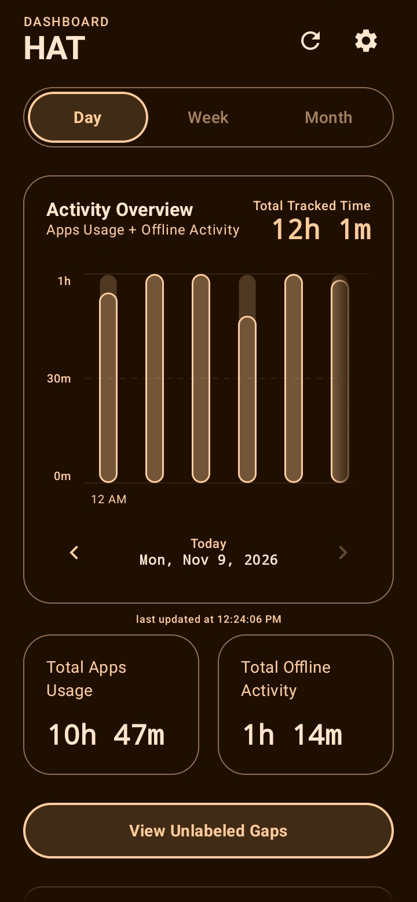
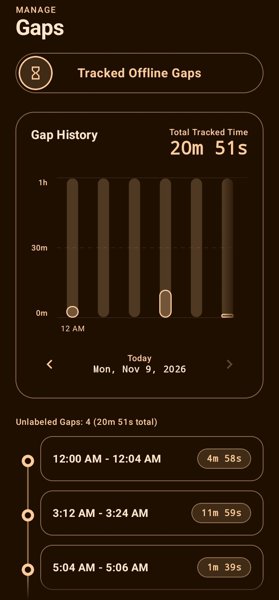
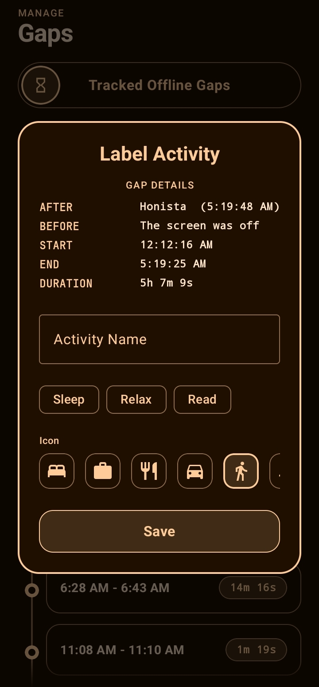
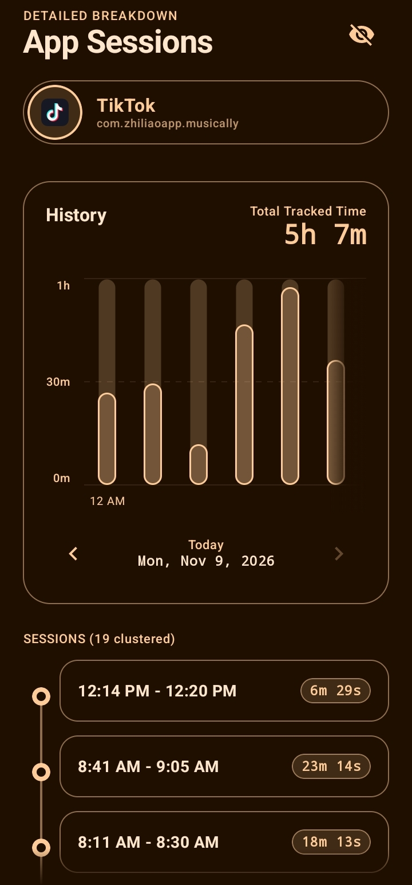
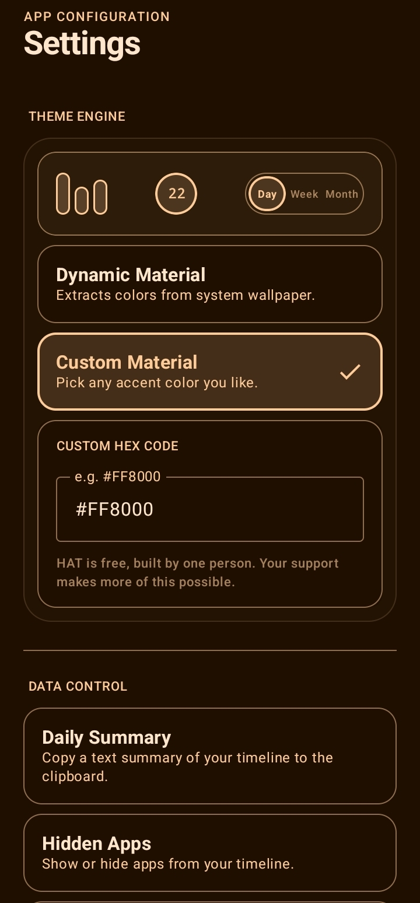

<div align="center">

<br/>


# Heuristic Activity Tracker

*Your entire day, reconstructed. Locally. Privately. Yours.*

<br/>

[](https://www.gnu.org/licenses/agpl-3.0)
[](#dynamic-theme-engine)
[](https://developer.android.com)
[](https://kotlinlang.org)
[](https://developer.android.com/jetpack/compose)
[](https://andromedvn.github.io/HAT/PRIVACY.html)
[](#privacy--security)
[](#privacy--security)
[](https://github.com/andromedvn/HAT/releases)
[](https://ko-fi.com/andromedvn)

<br/>

[Privacy Policy](https://andromedvn.github.io/HAT/PRIVACY.html) · [Terms of Service](https://andromedvn.github.io/HAT/TERMS.html) · [Report a Bug](../../issues) · [Request a Feature](../../issues) · [Releases](../../releases)

<br/>

<a href="https://ko-fi.com/andromedvn">
  
</a>

<br/>

HAT will always be free with no ads and no locked features. If it's been useful to you, your support is what keeps the updates and more projects coming: <b><a href="https://ko-fi.com/andromedvn">ko-fi.com/andromedvn</a></b>, or alternatively tell a friend.

</div>

---

## What is HAT?

**HAT** is more than just a screen time tracker, it helps you track and label gaps when you are not using your phone.

<p align="center">
  
  
  
  
  
</p>

It does this by watching your app usage, something Android already tracks in the background, and inverting it. Every minute you weren't on your phone becomes an unlabeled block of time called a **gap**. You can leave those gaps empty, or fill them in: `Sleeping`, `Working`, `Reading`, `At the gym`. Over time, you end up with a complete picture of how you spend both your screen time and your offline time.

There are no accounts. No servers. No cloud sync. HAT has no internet permission at all, it can't send your data anywhere even if it wanted to. Everything lives in a local SQLite database on your device. You own it completely.

This is the full source code.

---

## Table of Contents

- [How It Works](#how-it-works)
- [Features](#features)
- [Architecture](#architecture)
- [The Heuristic Engine](#the-heuristic-engine)
- [What Was Removed and Why](#what-was-removed-and-why)
- [Data Model](#data-model)
- [Privacy & Security](#privacy--security)
- [Building from Source](#building-from-source)
- [Tech Stack](#tech-stack)
- [Project Structure](#project-structure)
- [Acknowledgments](#acknowledgments)
- [FAQ](#faq)
- [License](#license)

---

## How It Works

Most screen-time trackers just count how long you used each app. HAT does that too, but it also asks a harder question: what were you doing when you *weren't* on your phone?

Android's `UsageStatsManager` gives any app holding the Usage Access permission access to a log of when apps were opened, paused, resumed, and closed. HAT reads this log to build a complete minute-by-minute timeline for any day. When there's a continuous block of time with no app activity, that becomes a **gap**, an unaccounted period waiting to be labeled. And when an app keeps running while the screen is off, a playlist in your pocket, a lock-screen app, that span is split out as **Screen-Off Activity** instead of silently counting as screen time.

The flow looks like this:

```text
Android OS Events → UsageStatsEngine → HeuristicEngine → UI Timeline
                     (Interval Math)           │
                                               ├─> Screen-Off Isolation
                                               ├─> Gap Detection (Subtractive Scan)
                                               ├─> Gap Evidence (Raw Event Log)
                                               ├─> Session Clustering (1-Minute Merge)
                                               └─> Chart Bucketing (Hourly/Daily)
```

When you label a gap (say, "Sleeping" from 11 PM to 7 AM), that label gets stored in the local database alongside its timestamp and duration. It shows up in the offline timeline alongside your app usage. The two streams, digital and physical, are rendered together on the dashboard.

The archive worker runs by default, every 12 hours, and a catch-up sync runs when you open the app. Its interval is configurable in Settings (12h, 6h, 2h, or custom); there is no Off, because the worker is what copies your history out of Android's short-retention log before the system deletes it. The timeline itself is always queried fresh from the OS when you open the app.

---

## Features

### Core Tracking

**App Usage Timeline**. See exactly which apps you used and for how long, down to the session level. Each app entry can be drilled into to view individual session clusters: when you opened it, when you closed it, and how long each session lasted.

**Stacked Bars:** Tap a bar in the chart to see the split of screen time to offline gaps for that hour.

**Bi-Directional Highlighting:** Long-pressing a gap or app card automatically scrolls the chart to that exact block of time and highlights it. Long-pressing a bar in the chart auto-scrolls to the timeline below it and highlights the cards in that timeframe.

**In App Calendar:** Tap the date navigator below the chart to leap across months of data instantly.

**Offline Gap Labeling**. When you weren't on your phone, HAT shows you that gap and lets you label it. You can name it anything, pick an icon, and the entry is permanently stored in your timeline. Every gap card also explains itself: it names the apps recorded right before and right after the gap, so you know where the time sat before naming it. The labeling dialog shows the facts as plain rows: DURATION, START, END, BEFORE, AFTER - longest first, seconds on every time, and the day word (today, yesterday, then the date) whenever a gap crosses midnight. Facts only, no verdicts. A gap at a day boundary says so honestly instead of inventing a neighbor.

**Day / Week / Month Views**. Switch between granularities without losing your place. The interactive chart at the top of each screen adjusts to show hourly buckets (day view) or daily buckets (week and month views). Tapping a bar on the chart scrolls the list to the matching sessions.

**Batch Gap Operations**. Long-press multiple gaps to select them, then label the entire batch at once. Useful for recurring activities like "Commute" that appear across dozens of short blocks throughout the week.

**Smart Suggestions:** When you tap to label a gap, HAT suggests labels you have used at that time of day before, weighted by how close the hour is.

### Export & Integrations

**Daily Text Summary**. Copies a plain-text summary of a single day's app usage, labelled offline activities, and totals to your clipboard. The section headers are written as `[Offline Activities]`, `[App Usage]`, and `[Totals]`, bracketed labels, not Markdown headings, so they paste cleanly into a note or an LLM prompt without rendering as literal `##` syntax. (An earlier version of this README described it as a "Markdown Summary" and recommended Obsidian/Notion; the output has never been Markdown.)

**Master Vault (Backup & Restore)**. Your entire local database, app usage history, offline logs, hidden apps, dismissed sessions, dismissed screen-off gaps, can be exported as a single integrity-signed `.zip` file called the Master Vault. There is no encryption: the zip entries are plain files. What the export gives you is tamper detection, an HMAC-SHA256 signature over the contents, so a file that was modified or corrupted after export is rejected on import instead of being silently loaded.

### Screen-Off Activity

Sometimes an app keeps running for hours while the screen is off: music or a podcast left playing, a navigation app guiding a drive, a workout tracker on a run. No one is using the phone, so counting those hours as screen time would make every total wrong. HAT puts them into their own category, which is screen off activity.

Each gap gets its own card with the app, the exact hours, and two exits:

- **Name it**. The gap becomes an offline label, like any other
- **Count it as usage**. The gap is merged back into that app's totals

Nothing is auto-decided. A gap only lands here when the events show the app resumed while the screen was off, and gaps shorter than 15 minutes never surface at all. Dismissed screen-off gaps can be restored later from the Gaps screen.

### History Archiving

Android only retains usage event data for a limited window (typically a few weeks, varying by device and OS version). HAT includes a background `ArchiveSyncWorker` that silently wakes up on a configurable schedule to read and store your usage history before the OS permanently deletes it.

Before the first run, HAT asks you for the battery exemption (the in-app dialog), which keeps the worker alive on phones that aggressively pause background jobs.

The archive sync:
- Waits for a healthy battery: if the battery is low, the run is postponed until you charge up or the battery recovers, then it resumes automatically
- Backfills the entire backlog in one run, one 5-day pass at a time, until it reaches the beginning of your history
- Merges with live OS data so the timeline is always continuous

### Dynamic Theme Engine

HAT supports three theme modes:

- **Dynamic Material (Material You)**. On Android 12+, the theme derives its colors from your wallpaper using Android's system dynamic color. The entire app, backgrounds, borders, icons, text, adapts to your phone's accent color.
- **Custom Material**. You type a hex color and the whole app, including the launcher-styled preview of every element, derives its monochromatic palette from it. The preview updates as you type.
- **Static Default**. The classic deep orange palette (`#FF8000`) if you prefer the shipped look or are on Android 11 or earlier.

On devices below Android 12, the dynamic mode falls back to a monochromatic palette generated from the wallpaper's dominant color, a downsampled average the extractor computes with AndroidX color utilities.

### Settings

Four settings. Everything else was removed because one honest number beat overlapping ones.

| Setting | What it does |
|---|---|
| **Global Timeline Sort** | Order items by recent activity, total duration, or chronological first-use |
| **Gap Minimum** | Gaps shorter than what is set to this setting don't appear to declutter the timeline. A gap is time where you weren't on your phone. Presets: 1 min (the fresh-install default), 5 min, 15 min, or any custom value from 1 to 1440 minutes |
| **Session Merge** | Visits to the same app separated by less than what is set to this setting become one session on the details screen. Presets: 1 min (the default), 2 min, 5 min, or any custom value from 1 to 60 minutes |
| **Background History Sync** | How often the archive worker runs: 12 hours (the default), 6 hours, 2 hours, or custom. There is no Off: the worker is what keeps your history alive before Android deletes it. When the battery is low, the sync waits until the battery recovers. The battery exemption does not override this; it is what keeps the job alive when the OS would pause it |

Session merging has its own dial (see the table): visits to the same app within the tolerance become one session on the details screen. Gaps and charts are unaffected - merging shapes the session list only.

### Developer Diagnostics (Easter Egg)

Power users can unlock a hidden Developer Mode directly from the UI:
**Tap the "HAT" header (subtitle "Dashboard") 5 times in quick succession.**

This unlocks the hidden `DiagnosticsScreen`, allowing you to bypass the OS history retention limit flag, export raw calculated JSON event matrices, dump local crash logs, and manually clear all diagnostic logs.

### Hidden Apps

Any app can be hidden from the dashboard. Hidden apps are excluded from usage calculations entirely, they won't appear in the timeline and won't count toward total screen time; their time shows as gap time, marked as containing a hidden app. You can restore them from the Hidden Apps screen under Settings.

This is useful for system apps, launchers, and anything else that shows up in usage stats but isn't meaningful to your day.

### Crash Recovery

HAT has a custom crash handler. If the app encounters an unhandled exception, it writes a detailed crash log, including device information, a breadcrumb trail of the last 50 logged events, and a full stack trace, then launches a `CrashRecoveryActivity` instead of showing the generic Android crash dialog.

From the recovery screen you can export crash logs and diagnostic events, erase all data with "Factory Reset Engine", or simply safely restart the app.

---

## Architecture

HAT uses MVVM with Jetpack Compose. A few of the design decisions are non-obvious enough to be worth documenting here.

### Layer Overview

```
+-----------------------------------------------------+
|                      UI Layer                       |
|  Compose Screens -> ViewModels -> StateFlows        |
+-----------------------------------------------------+
|                    Domain Layer                     |
|  HeuristicEngine - pure computation, no I/O         |
+-----------------------------------------------------+
|                     Data Layer                      |
|  ActivityRepository - coordinates all data access   |
|    |-- UsageStatsEngine (OS events, live)           |
|    |-- OfflineStorage (SQLite + DataStore)          |
|    `-- VaultSecurity (export/import)                |
+-----------------------------------------------------+
|                    Worker Layer                     |
|  ArchiveSyncWorker (WorkManager, periodic)          |
+-----------------------------------------------------+

```

### Key Design Decisions

**No background service.** HAT never runs a foreground service or long-lived background process. Querying `UsageStatsManager` at app-open time is fast enough (milliseconds for most date ranges), and the archive worker handles the rare case where historical data would otherwise be lost.

**Interval-based computation.** Rather than storing pre-computed totals, HAT stores raw time intervals (start ms → end ms) and computes everything, durations, totals, chart data, gap detection, at query time. This makes retrospective recalculation free. If you change settings (like the Gap Minimum), your entire history is immediately recalculated without any migration.

**Layered cache.** `ActivityRepository` maintains an in-memory interval cache keyed on the queried time window. Cache hits skip both the SQLite query and the OS query. The cache is invalidated on a 5-minute TTL or when data-mutating operations are performed (vault restore, hiding apps, etc.).

**Coroutine-aware interval math.** All interval set operations, merging, subtracting, slicing into time buckets, yield periodically using `kotlinx.coroutines.yield()`. This prevents UI jank on large date ranges without requiring explicit threading annotations throughout the computation code.

**Semaphore-gated icon loading.** App icons are loaded concurrently but capped at 4 simultaneous loads via a Semaphore, with results cached in an LruCache. Preventing unbounded parallelism matters on mid-range devices that struggle with icon loading spikes during list renders.

---

## The Heuristic Engine

`HeuristicEngine` is the core computation layer. It takes raw interval data and produces everything the UI needs: sorted app usage lists, gap lists, chart data, and session clusters.

### Gap Detection

```
Total day window [00:00 → 24:00]
  minus  app usage intervals
  minus  offline activity intervals
  minus  screen-off spans
  ──────────────────────────────
= Unlabeled gaps
```

Hidden app time is NOT subtracted: it stays inside gaps, and any gap that overlaps a hidden app is marked as containing a hidden app.

The subtraction is done with `subtractIntervals()` in `IntervalMath`, which handles partial overlaps correctly, a gap that partially overlaps with an app session gets trimmed, not removed entirely.

### Gap Evidence

Since 1.1.1, HAT persists the raw event stream (screen on and off, keyguard, touches, app resumes). The log stays on the device and backs every number the labeling dialog shows: the duration, the start and end with seconds, and the recorded app on each side of the silence.

Facts only, no verdicts. The phone cannot tell watching from sleeping, so the dialog never claims what you were doing; it states what was recorded and lets you name the gap. Anything the log cannot prove stays off the card, and an unexplained stretch is called a gap
## What Was Removed and Why

HAT shipped with features it no longer has. They are listed here so nobody goes looking for them, and so the reasoning stays on the record.

**Idle Sessions and Lock Screen Activity (removed during the 1.1.2 development cycle).** These were the features HAT was originally built around: when an app sat in front for hours, HAT asked whether you were still using it, and it split lock-screen stretches into their own category. They are gone because the phone's log cannot prove watching from sleeping. The cards asked questions the evidence could not always settle, the question cards multiplied faster than gaps, and a question HAT cannot answer from proof breaks the core rule: never lie. Their old suppression records were emptied in the version 5 database upgrade.

**The Idle Minimum dial (removed with them).** It existed to throttle how often those question cards appeared. With the questions gone, one dial (Gap Minimum) governs what surfaces.

**Sync Off (retired earlier).** The archive worker is the only thing standing between your history and Android's retention window, so turning it off would mean losing data silently. It runs on a schedule, and there is no Off.

What replaced the removed features is quieter and more honest: every unexplained stretch is one gap, and the raw event log backs every number the labeling dialog shows (see [Gap evidence](#gap-evidence)). If the data gets more accurate, features come back; accuracy first.

---

## Data Model

### SQLite Tables

HAT uses a single `hat_heuristic.db` database with Write-Ahead Logging enabled.

**`offline_activities`**. Stores user-created offline log entries.

| Column | Type | Description |
|---|---|---|
| `id` | INTEGER PK | Row identifier |
| `title` | TEXT | Activity name (e.g., "Sleeping") |
| `duration` | INTEGER | Duration in milliseconds |
| `timestamp` | INTEGER | Start time in Unix ms |
| `icon_name` | TEXT | Icon key (e.g., "Sleep", "Walk", "Work") |

**`archived_app_usage`**. Stores historical app usage intervals saved by the archive worker before the OS purges them.

| Column | Type | Description |
|---|---|---|
| `id` | INTEGER PK AUTOINCREMENT | |
| `package_name` | TEXT | App package identifier |
| `start_millis` | INTEGER | Session start in Unix ms |
| `end_millis` | INTEGER | Session end in Unix ms |

A unique index on `(package_name, start_millis, end_millis)` prevents duplicate archive entries.

**`raw_usage_events`** (schema version 4). The raw event stream as drained from `UsageStatsManager`: timestamp, event type, package, class. This is what gap evidence reads; every future day carries full presence proof.

**`ignored_sessions`** and **`ack_ghosts`**. Legacy suppression tables from the removed idle features. Both were emptied in the version 5 upgrade and are kept only so old vault files still restore.

**`screen_off_dismissed`** (schema version 3, 2026-10-16). Screen-Off Activity spans the user sent back to usage. Same shape as `archived_app_usage` (`package_name`, `start_millis`, `end_millis`, with a unique index on the triple). The engine merges these back into the app's totals so the same span never resurfaces as screen-off again.

### DataStore (Preferences)

Settings and hidden app lists are stored in Jetpack DataStore as JSON-serialized Kotlin data classes:

- `UserSettings`. All tunable engine parameters and theme preferences
- `Set<String>` of hidden package names

### Vault Format

The exported `.zip` contains three entries:
- `preferences.json`. Serialized `CombinedPreferences` (settings + hidden apps, plus the legacy idle-suppression tables so old vaults still round-trip)
- `database.db`. Raw SQLite file
- `signature.txt`. Base64-encoded HMAC-SHA256 of the concatenated bytes of the above two files

---

## Privacy & Security

HAT's privacy posture is structural, not policy-based.

**No internet permission.** `AndroidManifest.xml` does not declare `INTERNET` or `ACCESS_NETWORK_STATE`. The OS enforces this, the app cannot make network requests regardless of what any code tries to do.

**No analytics, no crash reporting service.** Crashes are logged to a local file. Diagnostic events are written to a local file. Nothing is transmitted.

**Usage Access is the only sensitive permission.** `PACKAGE_USAGE_STATS` is required to read app activity from `UsageStatsManager`. HAT does not request contacts, location, camera, microphone, notifications, or any other sensitive Android permission.

The full merged manifest also contains `READ_EXTERNAL_STORAGE` (capped at `maxSdkVersion 28`). Its only consumer is `WallpaperColorExtractor`, which reads the wallpaper's dominant colour for the pre-Android-12 dynamic-theme fallback; on those versions Android requires the permission for wallpaper access, and the extractor degrades gracefully to the static palette when it is not granted. `WAKE_LOCK` is contributed by `androidx.work` so `ArchiveSyncWorker` can be scheduled. `FOREGROUND_SERVICE` and `RECEIVE_BOOT_COMPLETED` are declared by `androidx.work` too, but HAT strips both from the merged manifest (`tools:node="remove"`) because it never runs a foreground worker and its alarm-path boot receiver is disabled at minSdk 26, the shipped binary declares neither. You can confirm the shipped set yourself with `aapt dump permissions`:

```bash
aapt dump permissions app/build/outputs/apk/release/app-release.apk
```

The privacy-critical result is that `INTERNET` and `ACCESS_NETWORK_STATE` are both absent, the former is never declared, and the latter is explicitly stripped from the `androidx.work` manifest, as are the unused `FOREGROUND_SERVICE` and `RECEIVE_BOOT_COMPLETED` entries. That is enforced in CI, which fails the build if `INTERNET` ever appears in a release manifest.

**All data is local.** The SQLite database lives in the app's private internal storage (`context.getDatabasePath()`). The DataStore preferences live in `context.dataStore`. Neither is accessible to other apps without root.

**Vault integrity checking.** Exported vaults are HMAC-signed. A modified or corrupted vault file will fail verification on import with an explicit error, rather than silently importing bad data.

**History limit transparency.** When querying historical data that predates Android's retention window, HAT explicitly tells you that the data is unavailable rather than silently showing zeros or missing time. The `bypassHistoryLimit` flag lets you opt into querying beyond the estimated retention boundary if you're curious.

**Don't take my word for it.** Every privacy claim above is checkable on the shipped binary, no trust required. Download the release APK, then:

```bash
# 1. The permission list, expect exactly this set and nothing else:
aapt dump permissions app-release.apk
#   android.permission.PACKAGE_USAGE_STATS
#   android.permission.READ_EXTERNAL_STORAGE   (maxSdkVersion 28, wallpaper theming)
#   android.permission.REQUEST_IGNORE_BATTERY_OPTIMIZATIONS   (the in-app battery dialog)
#   android.permission.WAKE_LOCK               (schedule the archive worker)
# No INTERNET. No ACCESS_NETWORK_STATE. No location, contacts, camera, or notifications.

# 2. Who signed the APK. Releases through 1.1.2 were debug-signed (the cert
#    would say so). This release carries the fingerprint below; if the cert
#    says DEBUG, you are not holding the real release.
keytool -printcert -jarfile app-release.apk
#   SHA-256: A8:DA:E3:05:7F:3A:AC:4A:B8:95:50:5C:7B:07:E0:1D:64:3A:F3:E2:5B:C3:6E:D0:82:F2:D0:28:9D:95:B6:EC

# 3. The file itself, compare against the SHA-256 in the release notes:
sha256sum app-release.apk
```

Feel free to go further. Decompile the APK with any Android tool, jadx, apktool, whatever you like, and look around. There is nothing to find, because there is nothing there: no network code, no analytics, no third-party SDK that could phone home. That's the whole point of publishing the source.

---

## Building from Source

### Requirements

HAT compiles with standard desktop tools:

- A recent Android Studio (Narwhal / Meerkat or newer). AGP 8.13 needs a
  current IDE, not Hedgehog (2023.1.1)
- JDK 17
- Android SDK Platform 36 (`compileSdk` / `targetSdk` are 36, `minSdk` is 26)
- A device or emulator running Android 8.0 (API 26) or higher

### Steps

```bash
# Clone the repository
git clone https://github.com/andromedvn/HAT.git
cd HAT

# Build a release APK
./gradlew assembleRelease
```

For a release build, you'll need to configure signing. See the [Android documentation on signing](https://developer.android.com/studio/publish/app-signing) for details.

### Granting Usage Access

After installing, the app will prompt you to grant Usage Access permission. This can't be granted via `adb`, you have to navigate to **Settings → Digital Wellbeing & parental controls → Usage Access** (the exact path varies by manufacturer) and enable it for HAT manually.

If you're setting up an emulator or test device via script, you can simulate granting this permission with:

```bash
adb shell appops set andromedvn.heuristic.activity.tracker GET_USAGE_STATS allow
```

---

## Tech Stack

| Component | Library |
|---|---|
| UI Framework | Jetpack Compose (BOM) |
| Navigation | Navigation Compose |
| Architecture | MVVM + StateFlow |
| Async | Kotlin Coroutines |
| Local DB | SQLite (via `SQLiteOpenHelper`) |
| Preferences | Jetpack DataStore Preferences |
| Background Jobs | WorkManager |
| Serialization | kotlinx.serialization |
| Theme | Material 3 + Dynamic Color |
| Usage Data | Android `UsageStatsManager` |
| Vault Security | HmacSHA256 (javax.crypto) |
| Crash Handler | Custom (no third-party SDK) |

**No third-party analytics, ad SDKs, or remote config libraries are used.**

---

## Project Structure

```text
app/src/main/kotlin/andromedvn/heuristic/activity/tracker/
│
├── MainActivity.kt                  # Entry point, navigation host, splash routing
├── CrashRecoveryActivity.kt         # Post-crash UI and log export
│
├── worker/
│   ├── ArchiveSyncWorker.kt         # CoroutineWorker for background history archiving
│   ├── AutoBackupWorker.kt          # Scheduled Rolling Vault writer
│   └── WorkerScheduler.kt           # WorkManager setup and cancellation
│
├── domain/
│   ├── HeuristicEngine.kt           # Core computation: gaps, sessions, charts, screen-off
│   ├── UsageEventReplay.kt          # Replays raw OS events into usage / screen-off intervals
│   ├── ChartSync.kt                 # The one bucket key for chart/list matching
│   ├── IntervalMath.kt              # Interval set operations (merge, subtract, slice)
│   ├── IntervalOverlapIndex.kt      # Sorted sweep index for overlap queries
│   ├── LocalDay.kt                  # Timezone-local day boundary math (DST-safe)
│   ├── ArchiveCursor.kt             # Archive walk planning (advances on empty days)
│   ├── DetailLevel.kt               # The Gap Minimum mapping: presets, custom, merge tolerance
│   ├── SettingsMigration.kt         # One-time settings migrations
│   ├── DashboardTourSteps.kt        # The onboarding tour data
│   ├── NavRouteCodec.kt             # Crash-safe navigation route encoding
│   └── SupportPromptPolicy.kt       # One-time support prompt timing
│
├── data/
│   ├── ActivityModels.kt            # Data classes and sealed interfaces for the whole app
│   ├── ActivityRepository.kt        # Coordinates OS, archive, and offline data sources
│   ├── DatabaseSchema.kt            # Table and index DDL
│   ├── HatDatabaseHelper.kt         # SQLiteOpenHelper, schema versioning, migrations
│   ├── OfflineOverlapSql.kt         # By-title overlap queries against archived usage
│   └── OfflineStorage.kt            # DataStore + SQLite CRUD, vault merge logic
│
├── viewmodel/
│   ├── DashboardViewModel.kt        # Dashboard state: date nav, gap ops, gap evidence, screen-off
│   └── ActivityDetailsViewModel.kt  # Per-app or per-activity detail state
│
├── ui/
│   ├── screens/
│   │   ├── DashboardScreen.kt       # Main timeline + app + offline activity lists
│   │   ├── ActivityDetailsScreen.kt # Drill-down session view for apps or offline items
│   │   ├── LabelGapsScreen.kt       # Gaps, screen-off activity, and gap evidence resolution
│   │   ├── PermissionScreen.kt      # Onboarding, "How HAT Works", vault restore
│   │   ├── OfflineStatsScreen.kt    # Dedicated analytics for offline logs
│   │   ├── AppUsageStatsScreen.kt   # Dedicated analytics for app usage
│   │   ├── SettingsScreen.kt       # Engine config, vault, hidden apps, support, about
│   │   ├── HatSplashScreen.kt       # Animated splash with custom HAT logo drawing
│   │   ├── HiddenAppsScreen.kt      # Manage hidden package list
│   │   ├── DiagnosticsScreen.kt     # Developer Easter Egg UI
│   │   └── LicensesScreen.kt        # Third-party license texts
│   ├── components/
│   │   ├── Charts.kt                # Interactive scrollable bar chart component
│   │   ├── CommonComponents.kt      # Shared UI blocks (dialogs, ledger rows, stat cards, theme preview)
│   │   ├── TourOverlay.kt           # The spotlight tour overlay
│   │   └── SupportPrompt.kt         # The one-time support dialog
│   └── theme/
│       ├── Theme.kt                 # MaterialTheme setup, dynamic color generation
│       ├── ColorParsing.kt          # Hex color input parsing and validation
│       └── Type.kt                  # Typography scale (sans-serif + monospace pairing)
│
└── utils/
    ├── UsageStatsEngine.kt          # Raw OS event parsing, interval math
    ├── HeuristicQuotes.kt           # Context-aware tip text for the chart tooltip
    ├── VaultSecurity.kt             # HMAC-signed zip export/import
    ├── VaultRestore.kt              # The one restore + safe-restart flow
    ├── AppIconLoader.kt             # Semaphore-gated icon loading with LruCache
    ├── AppLinks.kt                  # External links (support, licenses)
    ├── HatLogger.kt                 # Breadcrumb logger + crash handler + file logging
    ├── WallpaperColorExtractor.kt   # Dominant color extraction for dynamic theming
    ├── TimeUtils.kt                 # Duration formatting (ms → "2h 14m", etc.)
    └── PermissionUtils.kt           # Usage stats permission check
```

---

## Acknowledgments

Special thanks to **[Atharok's Screen Time](https://gitlab.com/Atharok/ScreenTime)** for pioneering the open-source offline gap-tracking concept. Their initial architecture heavily inspired the subtractive gap scan used within the HAT engine.

---

## Contributing

HAT is a personal project released as free software under the AGPL-3.0 license. Pull requests are not accepted.

You can still help: file an issue for bugs or feature requests.

### Bug Reports

Open an issue with:
- Android version and device model
- Steps to reproduce
- What you expected to happen vs. what actually happened
- A crash log if available (Dashboard → tap the header 5 times → Diagnostics → Export Crash Logs)

---

## FAQ

**Does this drain my battery?**

No. HAT has no background service. It queries `UsageStatsManager` when you open the app, which takes a few hundred milliseconds at most. The archive worker runs on a configurable schedule (default: every 12 hours, no Off: it is what keeps your history alive before Android deletes it) and is constrained to only run when the battery is not low.

**Why can't I see data from before I installed HAT?**

Android's `UsageStatsManager` only retains event data for a limited period, typically between 2 weeks and a few months, depending on your device and OS version. Data older than that is permanently deleted by the OS. HAT's archive worker saves usage data before this window closes, but it can only save data that was still available when it first ran. If you installed HAT recently, older history is unrecoverable.

**Can I use this on a custom ROM or degoogled phone?**

Yes, with a caveat. The `UsageStatsManager` is part of AOSP, so it works on most custom ROMs. The dynamic color theme (`ThemeType.DYNAMIC`) requires Android 12's dynamic color system, which may not be present on some custom ROMs. If it's missing, HAT automatically falls back to the static orange theme.

**Why SQLite instead of Room?**

SQLite directly via `SQLiteOpenHelper` gives explicit control over transaction batching, which matters for the vault merge operation (merging thousands of archived intervals in a single transaction with periodic yielding). Room adds abstraction that would complicate this. The schema is simple enough that Room's benefits don't outweigh the added indirection. (HAT's own schema is plain SQLite, but the shipped APK does contain Room classes: `androidx.work` uses Room internally to store its own bookkeeping. HAT never touches that database, and Room's `MultiInstanceInvalidationService` is inert in a single-process app.)

**Can I export my data to CSV or JSON?**

Yes. HAT contains a hidden Developer Diagnostics screen. By tapping the "HAT" header (subtitle "Dashboard") 5 times in quick succession, you can unlock Developer Mode and export a "Total Unbounded Matrix", a complete JSON dump of your computed intervals. You can also export diagnostic logs and crash stack traces from here.

**Is this available on F-Droid or Google Play?**

No, and that is a decision rather than a pending step. HAT is distributed through [GitHub Releases](https://github.com/andromedvn/HAT/releases) only. An F-Droid request for approval was opened and later closed; it is not being pursued. Play Store distribution is not planned.

**Who built this?**

[andromedvn](https://github.com/andromedvn). One person, no company, no budget, currently going full-time on this. (The first prototypes were built on-device with [ACS (Android Code Studio)](https://github.com/AndroidCSOfficial/android-code-studio); HAT is now built on desktop.)

---

## License

```text
HAT - Heuristic Activity Tracker
Copyright (C) 2026 andromedvn

This program is free software: you can redistribute it and/or modify
it under the terms of the GNU Affero General Public License as published by
the Free Software Foundation, either version 3 of the License, or
(at your option) any later version.

This program is distributed in the hope that it will be useful,
but WITHOUT ANY WARRANTY; without even the implied warranty of
MERCHANTABILITY or FITNESS FOR A PARTICULAR PURPOSE. See the
GNU Affero General Public License for more details.

You should have received a copy of the GNU Affero General Public License
along with this program. If not, see <https://www.gnu.org/licenses/>.
```

See [LICENSE](LICENSE) for the full text.

### Licensing for organisations

The AGPL is not an obstacle for most people, if you modify HAT for yourself,
or run it for yourself, you are fine. It becomes a problem when an organisation
wants to build on HAT without releasing its own source, or wants to run a
modified version as a network service: the AGPL then obliges them to publish
their corresponding source under the same terms.

If that does not work for you, a **commercial licence** is available. It permits
use in closed-source products and internal network deployments without a
disclosure obligation, and includes support from the maintainer.

Commercial licensing is negotiated directly. There is no store, no in-app
purchase, and no listing. HAT is distributed through GitHub Releases only.
Open an issue on this repository describing your use case, or use the contact
method on my [GitHub profile](https://github.com/andromedvn).

The repository's `LICENSE` stays AGPL-3.0. A commercial licence is granted per
organisation, as a separate agreement; it is not a relicensing of the project.
